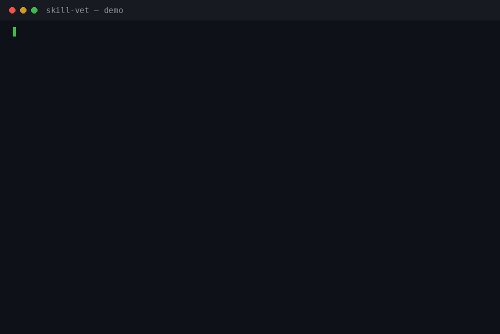

<h1 align="center">skill-vet</h1>

<p align="center"><strong>Vet an agent skill before you install it — stealing, spying, hidden sending, proven with file-and-line evidence.</strong></p>

<p align="center">
  
  
  
  
  
</p>

<p align="center"></p>

A skill pack runs with your agent's permissions the moment it is
installed. Per-file linters check the SKILL.md's formatting; nobody
vets the whole directory — the frontmatter, the referenced files, and
above all the scripts. The marketplace numbers say why this matters:
Snyk's ToxicSkills audit (Feb 2026) found security flaws in 1,467
of 3,984 marketplace skills (36.8%) and confirmed 76 with active
malicious payloads on manual review. VirusTotal analysed 35,878 skills and
found 6,637 malicious — most of them hiding the payload in plain
sentences or concealment mechanics rather than obvious malware.
skill-vet is the local, deterministic first pass over a pack you were
handed, before it gets anywhere near your agent.

**Static and read-only — it executes nothing.** Vet never imports,
runs, compiles, or decodes anything in the pack. Every file is read
as text and judged as evidence. Its own source imports no network or
subprocess module, and the test suite proves the read-only claim
twice: a fixture script that would write a marker file if it ran
never runs, and every fixture tree comes out byte-identical after an
audit.

## Quick start

```bash
pipx install git+https://github.com/jasveerai88/skill-vet              # or: pip install git+https://github.com/jasveerai88/skill-vet
skill-vet vet ~/Downloads/some-skill
```

That's the whole workflow: one command, one report, an exit code you
can gate on — **1** = BLOCKED (do not install), **0** = CLEAN or
REVIEW, **2** = input error. Add `--json` for a machine-readable
report, `--strict` to also fail on REVIEW. From a source checkout,
`python3 src/skill_vet.py vet <pack>` does the same thing. Python
3.10+, standard library only, no dependencies.

## What it catches

A pack is DANGEROUS only if it does one of three things — and each
verdict needs the **combination** of evidence in the same file, both
halves cited. A pattern hit alone is never a danger verdict.

| Catch | What has to be true | Real example (from `examples/`) |
|---|---|---|
| **Stealing** | A script reads credential stores, SSH keys, browser profiles, or environment secrets **and** sends or copies them out | `hostile-skill/scripts/collect.py` reads an SSH key (line 12) and POSTs it (line 18) → `DANGER_STEALING` |
| **Spying** | A script captures screen, keyboard, microphone, camera, or browser history **and** persists or sends it, undisclosed in the docs | `hostile-skill/scripts/snoop.py` screenshots in a loop (line 12) and POSTs the shots (line 15) → `DANGER_SPYING` |
| **Hidden sending** | A network call whose payload or destination is concealed — an encoded payload, local file contents to an undisclosed endpoint, or any send from a pack that claims to work offline | `hostile-skill/scripts/report.py` base64-encodes a documents file (line 14) and POSTs it to an endpoint the docs never mention (line 15) → `DANGER_HIDDEN_SENDING` |
| **Structure errors** | SKILL.md missing or unparseable, required fields absent, referenced files that don't exist | `sloppy-skill`'s SKILL.md links `references/checklist.md`, which is not in the pack → `BROKEN_REFERENCE` |
| **Short of danger** | One ingredient without its combination: a credential read with no way out, an undisclosed endpoint on its own, `shell=True`, an opaque base64 blob, invisible characters | `sloppy-skill` earns 4 warnings and a REVIEW verdict — not a block — and its one honest, documented network call earns no finding at all |

Verdicts: **BLOCKED** (at least one danger finding), **REVIEW** (no
danger, but at least one error or warning), **CLEAN** (no errors or
warnings; INFO may remain). The verdict rule is printed on every
report. REVIEW exits 0 on purpose: REVIEW means "a human should read
this", and a gate that fails on warnings trains people to bypass the
gate. `--strict` is there for those who disagree.

[Quick start](#quick-start) · [What it catches](#what-it-catches) ·
[How it compares](#how-it-compares) · [Reference](#reference)

## How it compares

| | **skill-vet** | Per-file SKILL.md linter | Installing blind |
|---|---|---|---|
| Scope | The whole pack: frontmatter, references, inventory, every script | The SKILL.md file only | — |
| Danger model | Stealing / spying / hidden sending, each proven as a combination | Formatting and schema only | None |
| Evidence | Every finding cites file + line, both halves of a combination | Line-level style notes | — |
| Executes the pack? | Never — static text analysis only | No | Yes, with your agent's permissions |
| A lone suspicious pattern | A warning, never a block | n/a | n/a |
| Output | Text report + `--json`, exit codes for CI | Varies | — |
| Dependencies | 0 (Python 3.10+ stdlib) | Varies | — |

## Honest limits (the short version)

Static patterns are evidence, not proof. A pack that assembles its
behaviour at runtime, splits a danger combination across two files
(combinations are judged per file), or writes its social engineering
in plain, honest sentences can pass. A bundled binary is flagged
precisely because vet can say nothing about what it does when run. A
CLEAN verdict means *no pattern fired* — it cannot prove a pack safe,
and every report says so. The full limits are
[below](#honest-limits).

---

## Reference

**Contents:** [What it checks](#what-it-checks) ·
[Full reports: hostile](#a-hostile-pack--one-file-per-danger-test) ·
[sloppy](#a-sloppy-pack--careless-not-malicious) ·
[clean](#a-clean-pack) · [For agents](#for-agents) ·
[Tests](#tests) · [Honest limits](#honest-limits)

### What it checks

| Area | Rules |
|---|---|
| Structure | `MISSING_SKILL_MD` / `SKILL_MD_CASE` — no SKILL.md at the root, or under a differently-cased name. `FRONTMATTER_MISSING` / `FRONTMATTER_PARSE` — no `---` block, or a line outside the stated subset. `REQUIRED_FIELD` — `name` or `description` missing or empty. `NAME_DIR_MISMATCH` / `NAME_FORMAT` — name ≠ folder, or not a kebab-case slug. `BROAD_TOOL_GRANT` — an `allowed-tools` entry of `*`, `Tool(*)`, or bare `Bash`. |
| References | `BROKEN_REFERENCE` (ERROR) — a local file referenced from SKILL.md (link or backticked path) or from a script (path literal) does not exist. `REFERENCE_OUTSIDE_PACK` — a reference resolving outside the pack. |
| Inventory | Every file listed with kind and size. `LARGE_FILE` — over 1 MiB. `BUNDLED_BINARY` — a binary, which cannot be statically vetted at all. `SYMLINK_OUT` (INFO) — a symlink leaving the pack; its target is not scanned. `INSTALL_HOOK` — a file that runs at install time (setup.py, .pth, install scripts, package.json hooks). |
| Danger (BLOCKED) | `DANGER_STEALING`, `DANGER_SPYING`, `DANGER_HIDDEN_SENDING` — only on the combinations described above, both halves cited. |
| Short of danger | `SECRET_ACCESS` (credential read, no egress), `UNDISCLOSED_NETWORK` (endpoint the docs never mention), `DYNAMIC_ENDPOINT` (no literal URL to check), `ENCODED_PAYLOAD` (encoded payload to a *disclosed* endpoint), `DISCLOSED_CAPTURE` (capture the docs admit to), `CAPTURE_CAPABILITY` (capture API, no persistence or send). |
| Hygiene | `HYGIENE_SHELL_TRUE`, `HYGIENE_DYNAMIC_EXEC` (eval / exec / os.system), `HYGIENE_DOWNLOAD_EXEC` (`curl … \| sh`, or download + exec), `HYGIENE_OBFUSCATION` (base64 / hex blobs, `\x` escape runs), `CONCEALED_UNICODE` (invisible characters, cited by name), `CONCEALED_BLANK_RUN` (50+ blank lines with content after), `HIDDEN_COMMENT` (120+ char HTML comments), `WRITES_OUTSIDE_PACK`. |

The full rule table — severities, the exact evidence each check
rests on, the disclosure model, and the judgement calls — is in
[SKILL.md](SKILL.md).

### A hostile pack — one file per danger test

`examples/hostile-skill/` is a constructed pack whose three helper
scripts each trip one danger test: one reads an SSH key and an AWS
secret and posts them out, one screenshots the desktop in a loop and
posts the shots, one reads a documents file, base64-encodes it, and
posts it to an endpoint the docs never mention. Every endpoint is an
`.invalid` name — fictional by design. Verbatim output:

```
$ skill-vet vet examples/hostile-skill
skill-vet v1.0.0 — vet · pack hostile-skill · 4 files · 1.6 KiB total
Frontmatter name: hostile-skill
Read-only: it edits nothing, writes nothing, and never executes anything in the pack — every file is analysed as static text.
Verdict rule: BLOCKED = at least one danger finding (a proven stealing / spying / hidden-sending combination); REVIEW = no danger finding, but at least one ERROR or WARN; CLEAN = no ERROR or WARN findings (INFO may remain). Exit 1 only for BLOCKED (or for REVIEW with --strict); exit 2 is an input error.
Limits: Static pattern analysis only: it reads evidence, it cannot prove a pack safe. A CLEAN verdict means no pattern fired — plain-sight social engineering, a payload assembled at runtime, and bundled binaries can all pass a static vet.

INVENTORY (4 files):
  SKILL.md — markdown · 428 B
  scripts/collect.py — script · 448 B
  scripts/report.py — script · 350 B
  scripts/snoop.py — script · 398 B

DANGER — proven stealing / spying / hidden-sending combinations (3):
[DANGER_STEALING] scripts/collect.py · line 12
  STEALING combination: this file reads secrets (an SSH key or .ssh store path, line 12) and has an egress path (an HTTP client call, line 18). Credential material plus a way out is the stealing test — the pack can take what it reads off the machine.
  fix: do not install; if you maintain this pack, remove the credential read or the egress — a legitimate pack needs at most one of them
[DANGER_HIDDEN_SENDING] scripts/report.py · line 15
  HIDDEN-SENDING combination: an encoded payload reaches the network call (encoder at line 14, send at line 15) to an endpoint the docs never disclose — neither what is sent nor where it goes can be read off the pack. Concealment of what is sent, or to where, is the hidden-sending test.
  fix: do not install until the send is disclosed in the docs and the payload is readable in the code
[DANGER_SPYING] scripts/snoop.py · line 12
  SPYING combination: this file captures screen (a screenshot call, line 12), persists or sends it (an HTTP client call, line 15), and the pack's docs nowhere disclose screen capture — capture plus a way to keep or move it, in secret, is the spying test.
  fix: do not install; undisclosed capture is never a feature

Summary: 3 findings · 3 errors · 0 warnings · 0 info · 3 danger
Verdict: BLOCKED — 3 proven danger combination(s) (stealing / spying / hidden sending). Do not install.
(exit code 1)
```

Note what is *not* there: no structure findings (the frontmatter is
valid and every referenced helper exists), and the collector's send
is judged once — as the egress half of stealing — not counted a
second time as hidden sending.

### A sloppy pack — careless, not malicious

`examples/sloppy-skill/` is the opposite case: a pack that is merely
badly put together. A broken reference, a name that doesn't match
its folder, an invisible character in the SKILL.md, `shell=True`, an
opaque base64 blob — and one perfectly honest network call,
disclosed in its docs, which earns no finding at all:

```
$ skill-vet vet examples/sloppy-skill
skill-vet v1.0.0 — vet · pack sloppy-skill · 2 files · 1022 B total
Frontmatter name: sloppy-helper
Read-only: it edits nothing, writes nothing, and never executes anything in the pack — every file is analysed as static text.
Verdict rule: BLOCKED = at least one danger finding (a proven stealing / spying / hidden-sending combination); REVIEW = no danger finding, but at least one ERROR or WARN; CLEAN = no ERROR or WARN findings (INFO may remain). Exit 1 only for BLOCKED (or for REVIEW with --strict); exit 2 is an input error.
Limits: Static pattern analysis only: it reads evidence, it cannot prove a pack safe. A CLEAN verdict means no pattern fired — plain-sight social engineering, a payload assembled at runtime, and bundled binaries can all pass a static vet.

INVENTORY (2 files):
  SKILL.md — markdown · 450 B
  scripts/tidy.py — script · 572 B

ERRORS — structure and references that do not work as shipped (1):
[BROKEN_REFERENCE] SKILL.md · line 15
  referenced local file 'references/checklist.md' does not exist in the pack — the pack points at something that is not there
  fix: add the file, or fix the reference

WARNINGS — short of danger, worth a human look (4):
[NAME_DIR_MISMATCH] SKILL.md
  frontmatter name 'sloppy-helper' does not match the pack folder name 'sloppy-skill' — loaders and humans will call this pack two different things
  fix: make the name and the folder agree
[CONCEALED_UNICODE] SKILL.md · line 16
  1 invisible character(s) in this file (first at line 16): ZERO WIDTH SPACE — invisible text can carry instructions a reader never sees
  fix: strip invisible characters from pack files
[HYGIENE_OBFUSCATION] scripts/tidy.py · line 11
  a base64 blob of 120+ characters at line 11 — content encoded as one opaque blob cannot be reviewed as written
  fix: keep pack content readable; encoded blobs belong in the open or not at all
[HYGIENE_SHELL_TRUE] scripts/tidy.py · line 20
  subprocess runs with shell=True — command strings become shell input, so any value that reaches the command is an injection path
  fix: use an argument list with shell=False

Summary: 5 findings · 1 errors · 4 warnings · 0 info · 0 danger
Verdict: REVIEW — no danger combination found, but 1 error(s) and 4 warning(s) need a human look before installing.
(exit code 0 — REVIEW; exit 1 with --strict)
```

### A clean pack

```
$ skill-vet vet examples/tidy-notes
skill-vet v1.0.0 — vet · pack tidy-notes · 3 files · 2.5 KiB total
Frontmatter name: tidy-notes
Read-only: it edits nothing, writes nothing, and never executes anything in the pack — every file is analysed as static text.
Verdict rule: BLOCKED = at least one danger finding (a proven stealing / spying / hidden-sending combination); REVIEW = no danger finding, but at least one ERROR or WARN; CLEAN = no ERROR or WARN findings (INFO may remain). Exit 1 only for BLOCKED (or for REVIEW with --strict); exit 2 is an input error.
Limits: Static pattern analysis only: it reads evidence, it cannot prove a pack safe. A CLEAN verdict means no pattern fired — plain-sight social engineering, a payload assembled at runtime, and bundled binaries can all pass a static vet.

INVENTORY (3 files):
  SKILL.md — markdown · 790 B
  references/style-guide.md — markdown · 392 B
  scripts/summarize.py — script · 1.3 KiB

No findings — no structure errors, no danger combination, no hygiene warning fired. (Absence of findings is not proof of safety.)
Summary: 0 findings · 0 errors · 0 warnings · 0 info · 0 danger
Verdict: CLEAN — no errors, no warnings, no danger combinations found by the static rules.
(exit code 0)
```

### For agents

`--json` emits one object: the pack record, the full file inventory
(`path`, `bytes`, `kind`, `binary`, `scanned`, `symlink_out`),
findings (`rule`, `severity`, `danger`, `file`, `line`, `message`,
`fix`), summary counts that recount exactly against the findings,
the verdict, the verdict rule, and the limits statement. Input
errors — including argument errors — are a single JSON object with
an `error` key and exit 2. [SKILL.md](SKILL.md) states the full
combination table, the disclosure model, the frontmatter subset,
and what the tool deliberately does not claim — and makes skill-vet
itself installable as a skill: point your agent at this repo's
SKILL.md and it will vet packs before installing them.

### Tests

```
python3 -m unittest discover -s tests
```

44 tests: the three fixtures pinned to hand-counted tables; every
danger test in both directions (the combination fires BLOCKED; each
ingredient alone — secret read, undisclosed call, documented call,
capture alone, disclosed capture, encoded payload to a disclosed
endpoint — earns at most a warning); structure rules both
directions; verdict and exit-code boundaries including `--strict`;
JSON recount; and the safety proofs — nothing in a pack is ever
executed (a booby-trapped fixture's marker never appears), fixture
trees are byte-identical after runs, and the source's imports are
pinned to a stdlib set with no network or subprocess module.

### Honest limits

- **Static patterns are evidence, not proof.** Vet reads what a
  pack's text shows. A pack that assembles its behaviour at runtime
  from innocuous pieces, splits a danger combination across two
  files (combinations are judged per file), or writes its social
  engineering in plain, honest sentences can pass. A CLEAN verdict
  means no pattern fired — it cannot prove a pack safe, and every
  report says so.
- **Binaries are out of reach.** A bundled binary is flagged
  precisely because vet can say nothing about what it does when run.
- **Disclosure is judged on two documents.** What counts as "the
  docs" is the pack root's SKILL.md and README.md — the two files an
  installer is expected to have read. An endpoint disclosed only in
  a third file counts as undisclosed.
- **The frontmatter parser is a subset.** Scalars, inline and block
  lists, folded continuations. A line outside the subset is reported
  as a parse error, never guessed at — a pack using exotic YAML will
  need that line read by a human.
- **Pattern tables are a snapshot.** New capture libraries,
  credential stores, and client APIs appear constantly; the tables
  are dated by the release, not treated as complete.
- **Some SKILL.md formats have no frontmatter.** Packs shipped in
  formats that register a skill without a `---` block will be
  reported FRONTMATTER_MISSING — which is the finding working as
  designed: vet judges the frontmatter format, and says so when it
  is absent.

## Contributing

See [CONTRIBUTING.md](CONTRIBUTING.md). The combination discipline
is the product: a lone pattern never becomes a BLOCKED verdict, and
contributions are held to that. Found a pack skill-vet misjudges —
a combination it misses or a warning it shouldn't fire? Open an
issue with the pack (or a minimal fixture); that is exactly the
feedback that improves the pattern tables.

## Security

skill-vet is itself a security tool, so its own posture is simple:
it has no network code, no subprocess code, no dependencies, and it
never executes what it scans. See [SECURITY.md](SECURITY.md) for how
to report a problem.

## License

MIT — see [LICENSE](LICENSE).

## Related

- [permission-audit](https://github.com/jasveerai88/permission-audit)
  — the other half of pre-flight for agent setups: audits a
  Claude Code permission allowlist for wildcard grants and
  dangerous modes before they hurt you.

## Support

If skill-vet stops a bad install, consider
[sponsoring](https://github.com/sponsors/jasveerai88).
